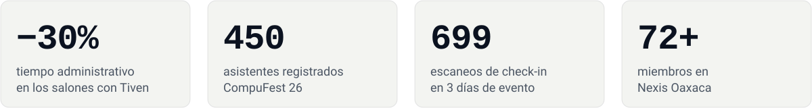
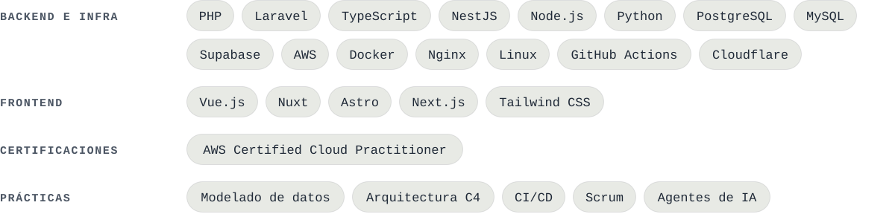

<picture>
  <source media="(prefers-color-scheme: dark)" srcset="./assets/hero-dark.svg">
  
</picture>

  
  
  
  
  

 

<picture>
  <source media="(prefers-color-scheme: dark)" srcset="./assets/metrics-dark.svg">
  
</picture>

  

<code>01 · PROYECTOS DESTACADOS</code>

## Casos de estudio: qué dolía, qué decidí y qué cambió.

### Tiven · SaaS para salones de belleza

`2025 – hoy` · `Backend Developer` · **−30% de tiempo administrativo**

**Problema.** Citas, inventario y seguimiento de clientes vivían en papel y hojas de cálculo; se perdían reservas. 
**Decisión.** Construí la API en Laravel sobre PostgreSQL para proteger la integridad de ventas, inventario y puntos, con colas de trabajo y caché. 
**Resultado.** Plataforma estable en producción que redujo 30% el tiempo administrativo de los salones.

Laravel · PHP · PostgreSQL · Docker · AWS · Vue.js · Astro &nbsp;→&nbsp; [tiven.app](https://tiven.app) · [Caso de estudio](https://joangarfias.me/proyectos/tiven)

### Civitas · Sistema para condominios

`2026` · `Fullstack Developer` · **Equipo ágil de 23 personas**

**Problema.** La seguridad reaccionaba después de los incidentes; reportes, comunicación y finanzas eran lentos y opacos. 
**Decisión.** Participé en el diseño de base de datos y arquitectura (modelo C4), monté entornos de prueba con Docker y la CI con GitHub Actions, y programé el módulo de empleados domésticos. 
**Resultado.** Módulos de seguridad, incidentes y acceso con QR entregados por sprints, con la deuda técnica bajo control.

NestJS · PostgreSQL · Docker · GitHub Actions · Cloudflare R2 · Stripe · Next.js &nbsp;→&nbsp; [Caso de estudio](https://joangarfias.me/proyectos/civitas)

### CompuFest 26 · Registro y check-in con QR

`2026` · `Único desarrollador` · **Construido en 2 días**

**Problema.** El foro necesitaba registro, gafetes y control de acceso para tres días de evento. 
**Decisión.** Construí con agentes de IA un flujo completo: registro con QR, gafetes en PDF, check-in por escaneo, panel en vivo y pantallas por zona que funcionan sin conexión. 
**Resultado.** 450 asistentes registrados y 699 escaneos en 5 puntos de acceso.

Nuxt · Cloudflare Functions · Supabase · Node.js · Cloudflare R2 &nbsp;→&nbsp; [compufest.pages.dev](https://compufest.pages.dev) · [Caso de estudio](https://joangarfias.me/proyectos/compufest-26)

<b>Más proyectos</b>

 

| # | Proyecto | Qué es | Stack |
| --- | --- | --- | --- |
| 04 | Sitio Universidad del Istmo | Sitio oficial rápido y editable por el personal sin el equipo técnico | Astro · Strapi · PostgreSQL · Docker |
| 05 | Curvex | Pruebas de hipótesis, regresiones y distribuciones con resultados al instante | Laravel · Vue.js |
| 06 | Hecho en Casa | Pedidos en línea para una repostería local: catálogo, calendario y pedidos personalizados | Laravel · MySQL |

 

<code>02 · STACK</code>

## Las herramientas detrás de cada proyecto.

<picture>
  <source media="(prefers-color-scheme: dark)" srcset="./assets/stack-dark.svg">
  
</picture>

  

<code>03 · SOBRE MÍ</code>

## Construyo software y construyo comunidad.

Estoy en el último año de Ingeniería en Computación en la Universidad del Istmo. Antes de escribir código, analizo el problema y su contexto; después planeo, delego código y pruebas a agentes de IA y reviso lo que entregan.

> Para mí son parte de lo mismo: crear las condiciones para que otros puedan llegar más lejos.

 

<code>04 · COMUNIDAD</code>

## Aprender. Construir. Compartir.

- **Cofundador de [Nexis Oaxaca](https://nexisoaxaca.tech):** comunidad tecnológica del Istmo de Tehuantepec con 72+ miembros y 30+ eventos.
- **Google Student Ambassador:** primera generación, 2026.
- **INROADER:** INROADS México.

| Fecha | Tipo | Título | Evento / lugar |
| --- | --- | --- | --- |
| Nov 2026 | Taller | Desarrolla software con Google Antigravity | CompuFest 26 |
| Nov 2026 | Charla | Panel: IA, universidad y el futuro del Istmo | CompuFest 26 |
| Nov 2026 | Organización | CompuFest 26, segundo foro regional de computación | UNISTMO |
| Oct 2026 | Charla | Gemini más allá del copiar y pegar | Semana Nacional de la Ciencia y la Tecnología, CETIS 168 |
| Oct 2026 | Taller | IA para tu negocio | Nexis Oaxaca |
| Sep 2026 | Charla | La IA no hace magia | IEBO Plantel 165, con Oaxacaciberseguro |

 

<code>05 · CONTACTO</code>

## Vamos a colaborar.

¿Tienes un proyecto, una vacante o un evento? Escríbeme desde [joangarfias.me](https://joangarfias.me/#contacto) o por [LinkedIn](https://linkedin.com/in/joangarfias).

 

© 2026 Joan Garfias · Construyo software con propósito desde Oaxaca, México.
